**Author:** Rylee Cobb  
**Completed:** November 11, 2026  
**Tool used:** Splunk  
**Lab:** [T1110-003 on CyberDefenders](https://cyberdefenders.org/blueteam-ctf-challenges/t1110003/)  
**MITRE ATT&CK:** [T1110.003 — Brute Force: Password Spraying](https://attack.mitre.org/techniques/T1110/003/)

## Scenario and approach

I specifically chose this T1110-003 CyberDefenders lab as my second lab to document because it involves Splunk and password spraying. I was excited to get some hands-on time in a Splunk lab environment! 

I started by expanding the scenario, but found that it didn't do much to set me up for the lab itself. The description is essentially the MITRE ATT&CK write-up for T1110.003. With that being said, I had a good idea of what I was up against:

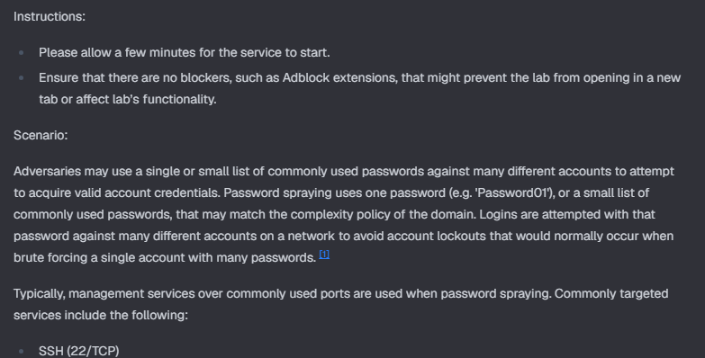

The lab uses Windows authentication and Remote Desktop Services events. My goal was to work through the evidence, figure out what happened, and explain *how* I found each answer rather than just list the answers.

## Q1 — Identify the last logged-on user

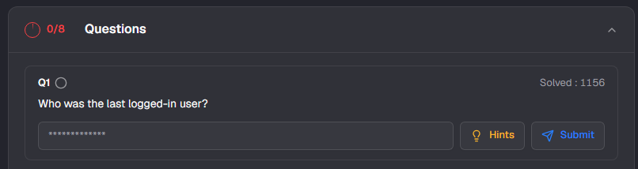

The first question asks who the last logged-on user was. I figured this should be pretty straightforward to identify.

Immediately upon opening Splunk, the search bar was already populated with `index="t1110-003"`. This was most likely configured by CyberDefenders for the purposes of the lab. An **index** is where Splunk stores searchable events, and this search returned 24,214 events. Wow.

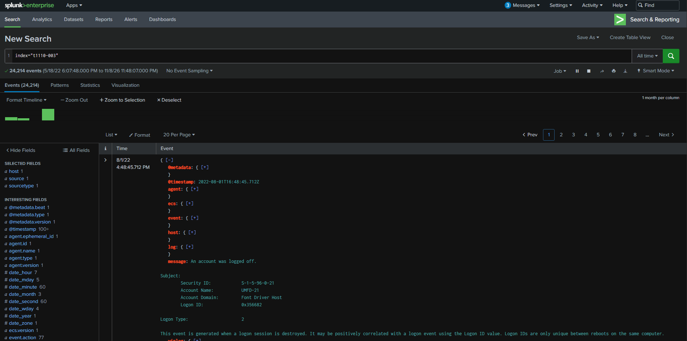

I expanded that search to look for successful logins specifically. I asked my AI assistant what wording to use, and it suggested the standard Windows logon message:

```spl
index="t1110-003" "An account was successfully logged on."
```

This narrowed the results to 1,800 events. Splunk displayed the newest events first, so I examined the first result, timestamped August 1, 2022, at 4:48:45.254 PM. Under New Logon, the account name was `Administrator` and the domain was `CYBERDEFENDERS`. It's important to use the *New Logon* account here, not assume the *Subject* account is the user who signed in.

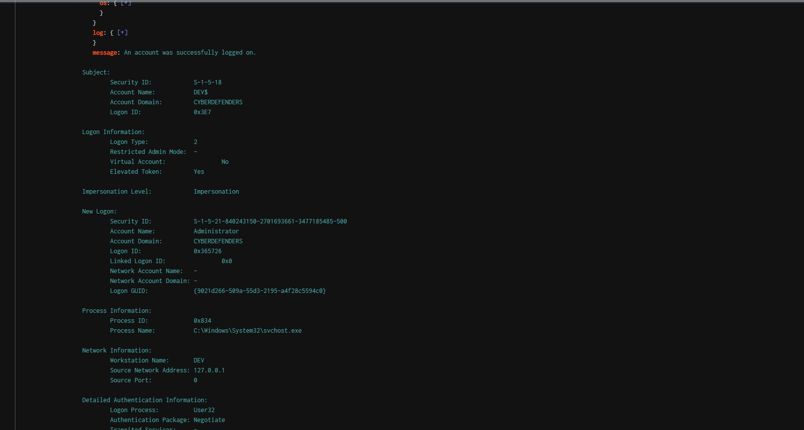

That gave me the last logged-on account shown in these results. Onto Question 2.

## Q2 — Identify the failed logon type

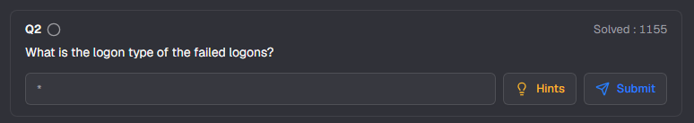

To find the logon type of the failed logins, I needed to refine my query again. I remembered from my CySA+ studies that Windows Event ID 4625 indicates a failed logon attempt, so I started by searching for that number:

```spl
index="t1110-003" 4625
```

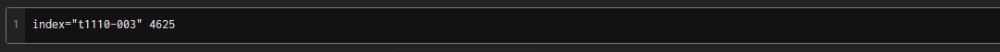

This was a quick text search for `4625`, not a strict filter on the event ID field, so I still checked the returned records to make sure I was looking at failed logons. The search returned 4,321 events. That's a lot of potential failed logins. Here's one of the events I examined:

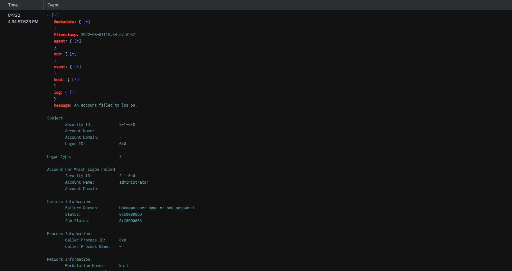

The Logon Type was 3, meaning a network logon was attempted. I looked through several other failed logon events and saw the same type.

Before moving on to Question 3, I think it's worth noting some details about this event. It doesn't look like a simple case of someone fat-fingering their password, at least at first glance.

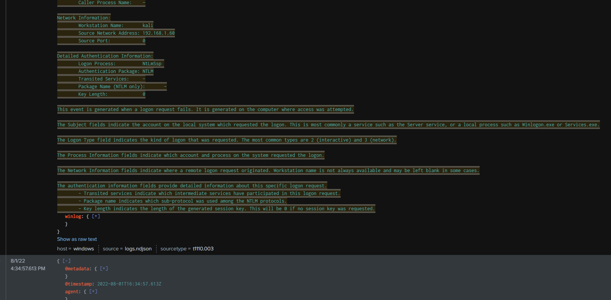

The account being targeted was `administrator`, and the failure information pointed to a bad username or password. The Network Information section showed a workstation named `kali` and source IP **`192.168.1.60`**. Those details caught my attention.

From what I've learned in my CySA+ studies, analysts shouldn't take a single event and draw broad conclusions without finding more evidence. I suspected I'd find similar activity if I looked at more events, especially considering that the lab is named after MITRE ATT&CK's password spraying sub-technique. In a real SOC, I'd want to correlate additional events before calling this an attack.

## Q3 — Determine the protocol being targeted

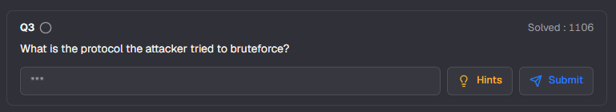

I knew the failed logons used Logon Type 3, so the attempts happened over the network. The logs also showed NTLM as the authentication package, but that didn't tell me which service the attacker was targeting. My first guesses were SMB, RDP, or possibly SSH, but I didn't have evidence for any specific service yet.

I decided to follow the IP address I had already found:

```spl
index="t1110-003" "192.168.1.60"
```

One of the more recent events referenced Remote Desktop Services. At 4:46:27.334 PM, the message showed that an RDP session had disconnected. That didn't prove how the failed logons happened, but it gave me somewhere to look.

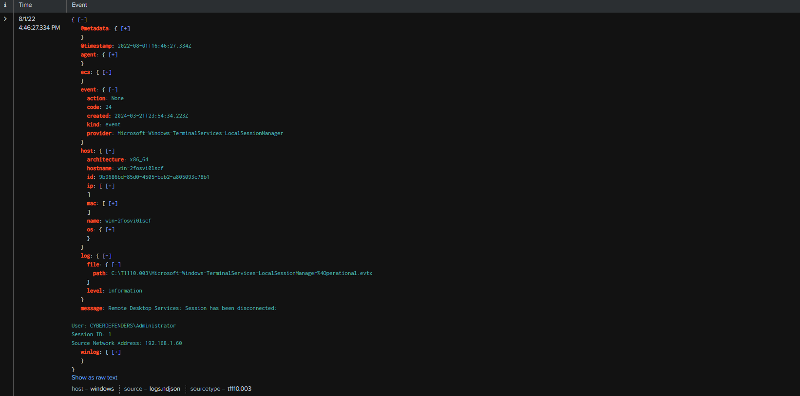

I also found a successful Windows logon at 4:46:09.987 PM from the same source IP, using the `Administrator` account.

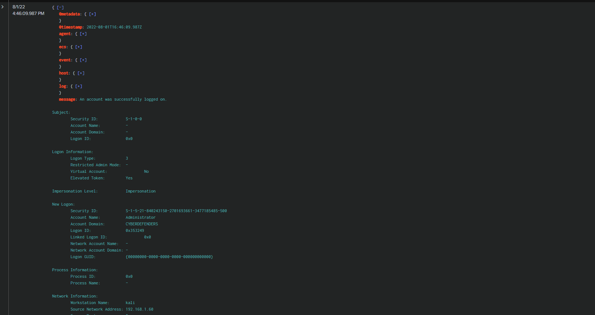

The next RDP-related event I looked at was timestamped 4:46:10.910 PM. Its message said Remote Desktop Services: User authentication succeeded, again with the same IP.

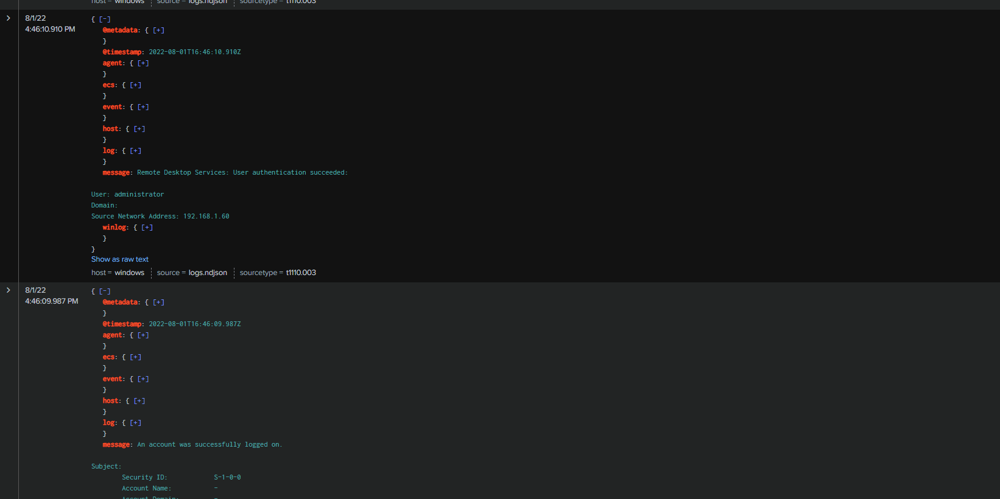

I wanted something more direct connecting this IP to RDP, so I also checked an earlier event at 4:34:57.747 PM. It was Event ID 131, from `Microsoft-Windows-RemoteDesktopServices-RdpCoreTS`, and its message said the server had accepted a new TCP connection from `192.168.1.60`.

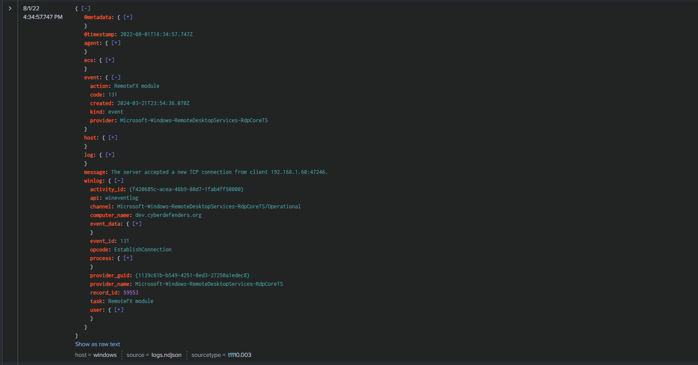

Together, these events gave me good evidence that RDP was the protocol involved. A failed Logon Type 3 event alone wouldn't have established that. Finding RDP connections from the same IP and related authentication activity made the conclusion much more defensible.

## Q4 — Count the successfully accessed accounts

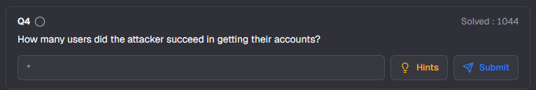

This one was somewhat straightforward. I knew the successful logon message from Question 1, and I now had the suspicious IP to narrow things down. I paired them in one search:

```spl
index="t1110-003" "An account was successfully logged on." "192.168.1.60"
```

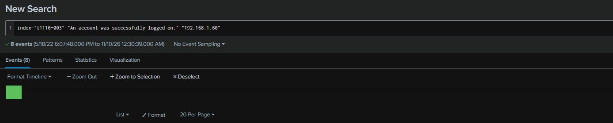

This returned 8 successful logon events. Three of them were for `Administrator` / `administrator` (the same account name with different capitalization), while the other five were different usernames. That gave me 6 unique accounts with successful logon events from this IP.

It's worth distinguishingeight events from six accounts. Also, a successful logon doesn't automatically prove that the account was maliciously compromised; the attribution comes from the broader attack context. For this lab, those were the successful accounts I identified from the suspicious source.

## Q5 — Interpret the failed-logon Sub Status

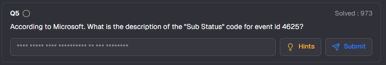

This was a quick Google search for the official documentation. In the Event ID 4625 logs, the relevant Sub Status was `0xC000006A`. I went to Microsoft Learn and found the description: "User logon with misspelled or bad password."

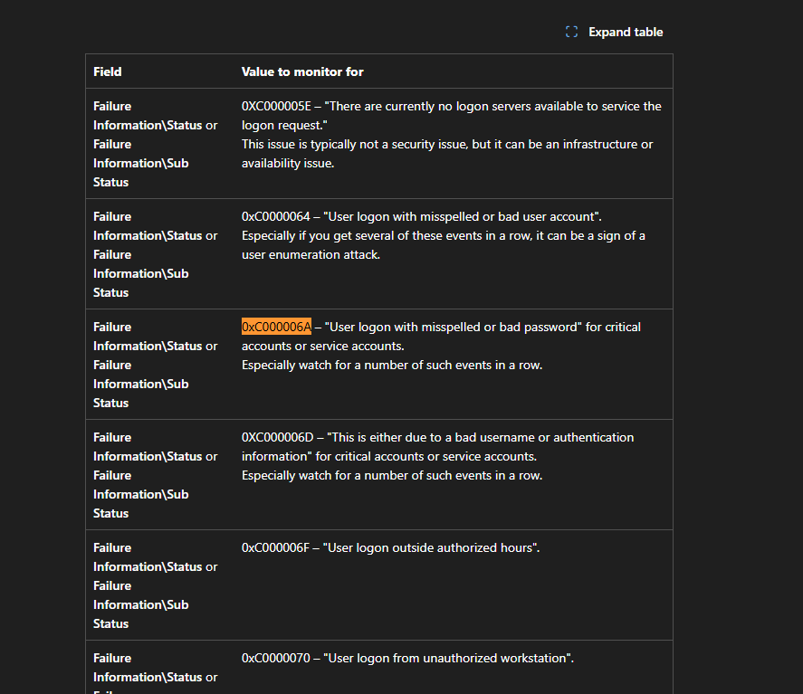

This helped me understand the difference between the general failed-logon message and the more specific reason behind the failure. Looking up the exact code in Microsoft's documentation made more sense than guessing what it meant.

## Q6 — Calculate the brute-force duration

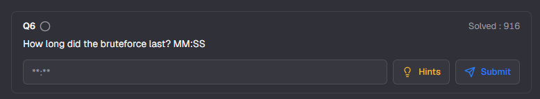

This question appeared to be asking for the time between the first and last failed logons in the attacker's guessing activity. I started by searching for failed logons from the suspicious IP:

```spl
index="t1110-003" "192.168.1.60" "An account failed to log on."
```

There were thousands of matching events. A related search where I included **both** successful and failed logons returned 4,310 results; I originally mixed that count up with the failed-only search. I manually scrolled to page 50 and found an event at 4:33:37.226 PM that I mistakenly thought was the oldest. When I compared it with the last failed logon at 4:34:57.623 PM, I calculated 01:20. I entered it into Question 6, but it was wrong.

I went back and consulted my AI assistant. It initially suggested that the Splunk Events view might have limited how far back I could scroll. That was a possible explanation, but I hadn't proven it. I also discovered that in one sorting attempt I'd used `time` instead of Splunk's actual timestamp field, **`_time`**. One missing underscore changes what the command does!

The working query to identify the oldest matching failed logon was:

```spl
index="t1110-003" "192.168.1.60" "An account failed to log on."
| sort 0 _time
| head 1
```

`sort 0 _time` sorts the matching events from oldest to newest by the event timestamp; the `0` tells Splunk to sort all matching results. `head 1` returns only the first event after sorting.

This returned the earliest failure at 4:29:09.460 PM, targeting `yokehorde` from `192.168.1.60`.

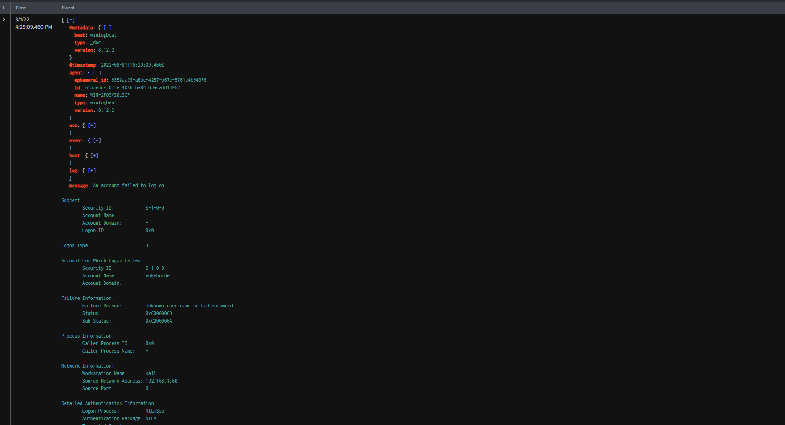

Next, I used the same search with a minus sign before `_time` to reverse the order and return the most recent failed logon:

```spl
index="t1110-003" "192.168.1.60" "An account failed to log on."
| sort 0 -_time
| head 1
```

That returned a failed attempt against `administrator` at 4:34:57.623 PM.

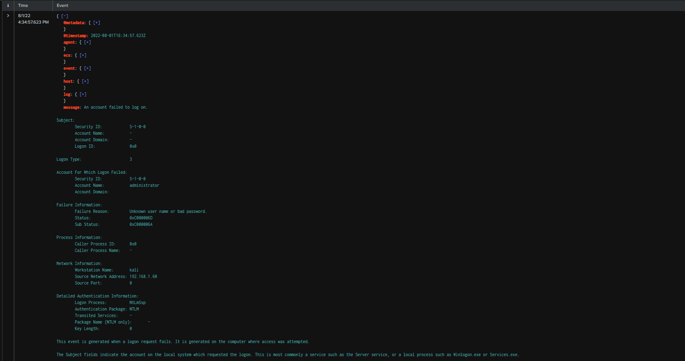

The time between 4:29:09.460 PM and 4:34:57.623 PM is 5 minutes and 48.163 seconds, or 05:48 in the lab's requested format. This measures the *observed failed-authentication window*, not necessarily the exact moment the attacker first gained access. I had also seen successful authentication activity around the end of that window, so the events weren't all happening neatly one after another.

This question took longer than I expected, but I learned why it's important to check the query itself instead of trusting that the last result I can scroll to is the oldest event in the dataset.

## Q7 — Find the gap before the next login

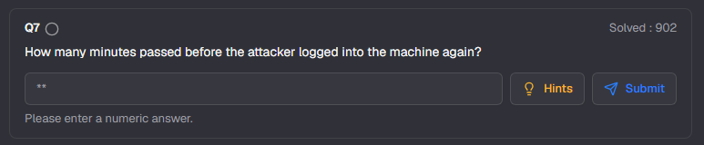

I returned to the successful Windows logon search:

```spl
index="t1110-003" "192.168.1.60" "An account was successfully logged on."
```

This gave me the same 8 successful authentication events. Looking at them from oldest to newest, the first five were different user accounts. The sixth was an `Administrator` logon at 4:34:57.020 PM, and the seventh was another `Administrator` logon at 4:46:09.987 PM.

That gap was 11 minutes and about 13 seconds. The question requested a numeric answer in whole minutes, so 11 was accepted. The eighth event, shortly afterward, was another logon for `administrator`, this time with Logon Type 10 (RemoteInteractive), which is consistent with RDP.

## Q8 — Identify the account lockout policy

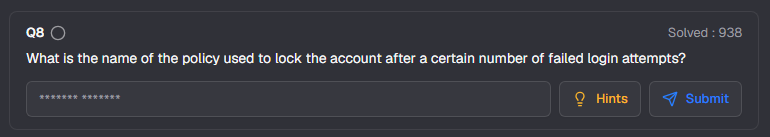

A simple Google search took me to Account Lockout Policy in Microsoft's Windows documentation. The question wanted a two-word answer, so Account Lockout was the answer for the lab.

More specifically, the Account lockout threshold setting determines how many failed sign-in attempts cause an account to lock. That can slow down password guessing, although overly aggressive settings can also let an attacker deliberately lock users out.

## Lessons learned

This lab challenged my understanding of basic Splunk queries and common brute-force attack behavior. I learned a lot about Windows events and how to interpret and correlate multiple events to form a bigger picture. It's nice to step away from the textbooks once in a while and actually get my hands dirty with practical, lab-based work. I enjoyed this lab despite its easy difficulty. I'm still building my technical skills, and this gave me another chance to get a rep in.

My biggest takeaways were learning the difference between authentication methods and the services being targeted, identifying accounts under New Logon, and being careful with timestamps and SPL syntax. I also got a better appreciation for why a single failed logon isn't enough evidence to explain an attack. Correlating events from different Windows providers made a much stronger case.

## Investigation limitations

One thing I kept thinking about after finishing the lab was how much I relied on `192.168.1.60` to follow the attacker. What if they changed their IP address during the attack? Searching only for that one source could make me miss other failed logons that were part of the same campaign.

If I were looking for a similar attack in a real environment, I'd want to widen the search and look for suspicious authentication patterns across accounts, IP addresses, and time, instead of relying only on one indicator. I didn't test that scenario in this lab, but it's something I want to keep in mind as I continue learning.

Also, the repeated failed logons and affected usernames fit the lab's password spraying scenario, but the Windows events don't show the passwords the attacker actually tried. I can describe the observed pattern without claiming I independently proved that the same password was reused across every account.

## References

- [CyberDefenders T1110-003 lab](https://cyberdefenders.org/blueteam-ctf-challenges/t1110003/)
- [MITRE ATT&CK: Brute Force — Password Spraying (T1110.003)](https://attack.mitre.org/techniques/T1110/003/)
- [Microsoft Learn: Event 4625 — An account failed to log on](https://learn.microsoft.com/en-us/previous-versions/windows/it-pro/windows-10/security/threat-protection/auditing/event-4625)
- [Microsoft Learn: Account Lockout Policy](https://learn.microsoft.com/en-us/previous-versions/windows/it-pro/windows-10/security/threat-protection/security-policy-settings/account-lockout-policy)
- [Splunk: `sort` command](https://help.splunk.com/en/splunk-enterprise/spl-search-reference/9.3/search-commands/sort)
